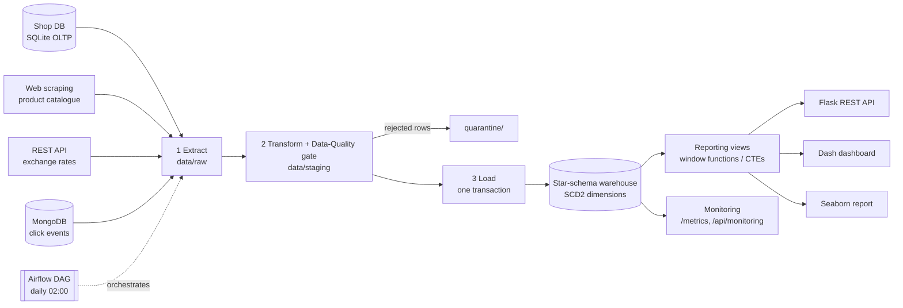

# ShopPulse - an end-to-end data platform for an online shop

ShopPulse collects data from **four different kinds of sources**, cleans and validates it,
loads it into a **star-schema data warehouse** (with history tracking), and serves it through a
**REST API, an interactive dashboard and a static report** - fully tested, containerised and
monitored.

It is a portfolio project: everything runs **locally and offline with one command**, no accounts needed.

```bash
pip install -r requirements.txt && pip install -e .
python -m shoppulse demo        # seeds sources, runs the pipeline, builds the report
python -m shoppulse api         # http://127.0.0.1:5000/api/kpis
python -m shoppulse dashboard   # http://127.0.0.1:8050
```

## Architecture



| Layer | What it does | Code |
|---|---|---|
| Sources | SQLite (SQL), web scraping (BeautifulSoup), REST API (requests, retries, fallbacks), MongoDB (PyMongo) | `sources/` |
| Transform | Pandas/NumPy cleaning, currency conversion, quarantine of bad rows | `transform.py` |
| Quality gate | Rule checks (error = stop the run, warn = log) incl. referential integrity | `quality.py` |
| Warehouse | Star schema, **SCD Type 2**, point-in-time joins, incremental upserts, triggers, indexes | `sql/ddl.sql`, `warehouse.py` |
| Analytics | Views with window functions (`LAG`, `RANK`, `NTILE`, moving averages), CTEs, cookbook queries | `sql/views.sql`, `sql/analytics.sql` |
| Serving | Flask REST API, Plotly Dash dashboard, Matplotlib/Seaborn report | `api.py`, `dashboard.py`, `report.py` |
| Orchestration | Airflow DAG (extract -> transform -> load -> report), retries, no overlapping runs | `dags/shoppulse_dag.py` |
| Ops | Docker, docker-compose, GitHub Actions CI, logging, run history, Prometheus metrics | `Dockerfile`, `.github/` |

## Data model

```
dim_date ----+                         +---- dim_product   (SCD2: price, rating, stock, band)
             +---- fact_orders --------+
dim_customer-+  (1 row per order)      
(SCD2: city, country, email, name)      fact_events_daily  (day x event type x device x product)
```

Operational tables: `etl_run_log`, `etl_watermark`, `dq_result`, `audit_order_status` (filled by a trigger).

## Engineering decisions worth discussing

* **Idempotent loads.** Running any load twice changes nothing: facts are upserted on the business key, SCD2 compares a row hash, aggregates are rebuilt. Tests prove it.
* **Incremental extraction with a watermark.** Only rows with `updated_at >= watermark` are read. `>=` (not `>`) on purpose: timestamps have 1-second resolution, and re-reading boundary rows is safe because the load is idempotent (at-least-once delivery + idempotent load = effectively exactly-once).
* **SCD Type 2 + point-in-time joins.** A customer who moves city gets a second dimension row; old orders keep pointing at the old city. A partial unique index guarantees one current row per business key.
* **Late-arriving data.** Facts whose dimension row is missing load against an "unknown member" (key `-1`) instead of failing.
* **Bad data is quarantined, never silently dropped.** Every rejected row is written to `data/quarantine/` with a `reject_reason`.
* **Quality gate before the warehouse.** Error-level failures stop the run; nothing partial reaches the warehouse.
* **All-or-nothing load.** Dimension and fact loads share one transaction; a failure rolls everything back (tested).
* **Stages communicate through files**, so each stage can be re-run alone and maps 1:1 to an Airflow task.
* **Resilient integrations.** Retries with exponential backoff; the rates API falls back to a cached copy, then to static rates; one failing scrape page does not kill the run.
* **Security basics.** Parameterised SQL only (injection test included), input validation with clear 400s, API key on write endpoints, non-root Docker user, gunicorn instead of the dev server.
* **Monitoring across four dimensions:** operational (run history, staleness), data quality, resources (memory, disk) and business logic (revenue-drop alert) - see `/api/monitoring` and `/metrics`.

## REST API

| Method & path | Purpose |
|---|---|
| `GET /health` | status, environment, last run |
| `GET /api/kpis` | revenue, orders, average order, customers, cancellation rate |
| `GET /api/sales/daily?from=&to=` | daily revenue, running total, 7-day average |
| `GET /api/sales/monthly` | monthly revenue and growth % |
| `GET /api/products/top?limit=&category=` | product ranking (overall and per category) |
| `GET /api/customers/top?limit=` | customers with value quartile |
| `GET /api/countries`, `GET /api/events/funnel` | country sales, browse-to-buy funnel |
| `GET /api/runs`, `/api/quality`, `/api/monitoring`, `/metrics` | operations |
| `POST /api/orders` | create an order in the shop DB (needs `X-API-Key` if configured) |
| `PATCH /api/orders/<id>/status` | change status; the next incremental run audits it via a trigger |
| `GET /api/orders/<id>/history` | status history written by the trigger |

## Run it

```bash
python -m shoppulse demo                 # everything, offline
python -m shoppulse seed --days 5        # the "shop" keeps selling
python -m shoppulse run                  # incremental run picks up only the new rows
python -m shoppulse sql list             # advanced-SQL cookbook
python -m shoppulse sql top3_products_per_category
python -m shoppulse status | monitor
docker compose up --build                # MongoDB + pipeline + API :5000 + dashboard :8050
docker compose --profile airflow up      # adds the Airflow UI on :8080
```

Configuration is by environment variables (see `.env.example`); `SHOPPULSE_ENV` marks dev / test / prod.
Without `MONGO_URI` an in-memory MongoDB (`mongomock`) is used, so no database needs installing.

## Tests and CI

```bash
make install && make test      # 90 tests, ~95% coverage
make lint                      # ruff
```

The suite covers parsing, retry/fallback behaviour (HTTP 503, bad JSON, offline), every cleaning rule,
quality checks, SCD2 history, point-in-time joins, idempotency, rollback on failure, triggers, SQL views,
every API endpoint (including validation, SQL-injection and API-key tests) and the dashboard figures.
GitHub Actions runs lint -> tests (Python 3.12 and 3.13, coverage gate 80%) -> an offline end-to-end run -> a Docker build and container smoke test.

## Environments

| Env | How | Purpose |
|---|---|---|
| dev | `python -m shoppulse demo` | local, offline, in-memory MongoDB |
| test | `pytest` / GitHub Actions | isolated temp folders, no network, deterministic data |
| prod-like | `docker compose up` | real MongoDB, gunicorn, API key, persistent volumes |

## Limitations and next steps

* SQLite is used so the project runs anywhere; the SQL is standard enough to move to PostgreSQL, and the warehouse module is the only place that would change.
* Batch only. A streaming path (events -> windowed aggregates) and a cloud deployment (managed orchestration, object storage, a cloud warehouse) are the natural next version.
* Data is simulated (with deliberately injected dirty rows); the catalogue scraper targets `books.toscrape.com`, a site built for scraping practice.
* Authentication is a single API key; a real deployment would use per-user auth and rate limiting.
